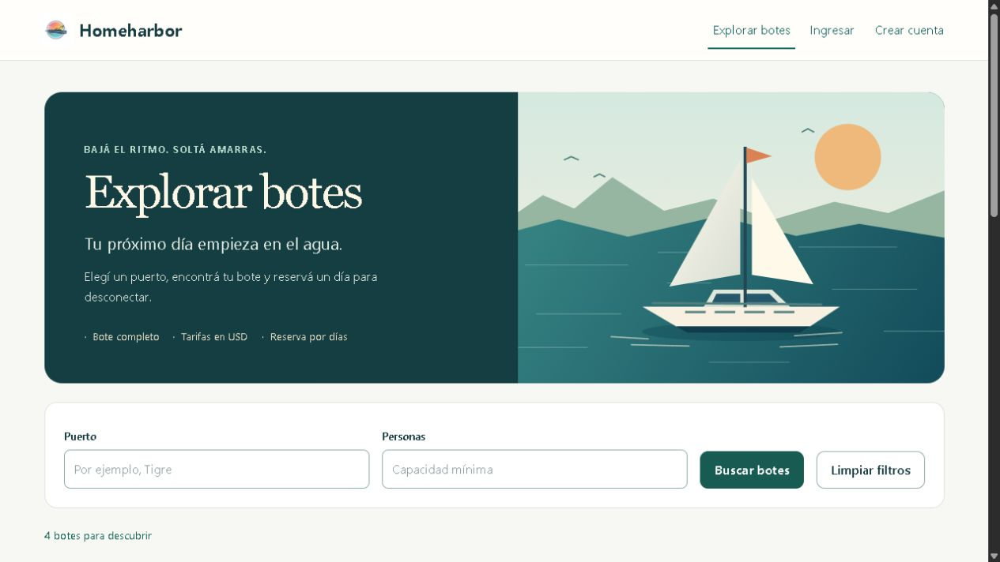

# Homeharbor

Plataforma para publicar y reservar botes completos por días, evolución de Reserve Boats, el proyecto grupal de Microverse.

[Caso de estudio y demo ES/EN](docs/demo/README.md) · [Texto para portfolio](docs/demo/PORTFOLIO.md) · [Despliegue y operación](docs/DEPLOYMENT.md)



## Un repositorio, dos aplicaciones

- `backend/`: Rails 8.1.4.1, Ruby 4.0.9, Devise 5.0.4 y PostgreSQL 18.6.
- `frontend/`: React 19.3.1, Vite 8.3.8 y Tailwind 4.3.5; Node 26.13.1 LTS.
- `docs/`: alcance, contrato y evidencia de verificación.
- `.github/workflows/ci.yml`: comprobaciones de ambas aplicaciones desde la raíz.
- `compose.yaml`: PostgreSQL local opcional.

El backend original de Homeharbor se trasladó conservando su historial Git y sus migraciones. Se incorporó el frontend actualizado de `final_capstone_front`. La estructura de `boats-reservation-v2` fue la referencia organizativa; no se copiaron sus endpoints de autenticación inseguros ni datos personales.

## Funciona en esta entrega

Registro con nombre, correo y contraseña; confirmación de correo; ingreso y salida; restauración de sesión; reenvío de confirmación y recuperación de contraseña. Las sesiones utilizan cookies cifradas, HttpOnly, SameSite=Lax, Secure en producción y CSRF en operaciones de escritura. Vencen tras 30 minutos de inactividad o 12 horas desde el ingreso.

Catálogo público con filtros por puerto y capacidad, paginación y fotos. Publicaciones propias: crear, consultar, editar, subir/eliminar fotos, desactivar y reactivar. Rails asigna al propietario desde la sesión y limita cada modificación a sus propios botes. Una cuenta puede publicar y consultar; no se implementaron administradores. Tarifas en USD y zona fija UTC−3, validadas también en PostgreSQL.

Reservas de botes completos por días: disponibilidad pública, cotización en USD calculada por Rails, confirmación, «Mis reservas», historial para el propietario y cancelación hasta 24 horas antes del inicio, inclusive. Del 10 al 12 se ocupan los días 10 y 11; el inicio es a las 00:00 UTC−3. PostgreSQL impide solapamientos y los reintentos recuperan la misma operación. El precio acordado y el historial se conservan aunque cambie o se desactive la publicación.

Los avisos de confirmación y cancelación se guardan con la reserva y un worker los entrega con reintentos. Un fallo de correo no deshace la operación. Catálogo, detalle y comprobante tienen diseño adaptable a móvil, navegación con teclado e ilustraciones identificadas como tales. [Evidencia y límites de E5](docs/E5_DEMO_PORTFOLIO.md).

Se implementó la propuesta inicial del MVP: confirmación automática sin cobros ni gestión separada de capitán. **Pendiente para una URL pública:** contratar/configurar hosting y dominio, verificar SMTP real, HTTPS y el recorrido desplegado. Docker y la operación están preparados y probados localmente. Ratificar el alcance comercial antes de uso real.

## Arranque estándar

Requisitos: Ruby 4.0.9 con Devkit en Windows, Bundler 4.0.20, Node 26.13.1 y PostgreSQL 18.6.

PostgreSQL debe ofrecer la extensión `btree_gist`; la migración de reservas la habilita para excluir intervalos superpuestos. La cuenta que ejecuta migraciones necesita permiso para instalarla. En un servicio administrado se debe comprobar su disponibilidad antes del despliegue.

1. Desde la raíz, definir `POSTGRES_PASSWORD` y ejecutar `docker compose up -d db`, o usar PostgreSQL instalado.
2. Configurar `DATABASE_URL` en la terminal del backend. Compose expone desarrollo en `127.0.0.1:5433/homeharbor_development`, usuario `homeharbor`. Codificar la contraseña para URL.
3. Configurar `FRONTEND_URL=http://127.0.0.1:5173`.
4. En una terminal:

```sh
cd backend
gem install bundler -v 4.0.20
bundle _4.0.20_ config set --local path vendor/bundle
bundle _4.0.20_ install
ruby bin/rails db:prepare
ruby bin/rails server -b 127.0.0.1 -p 3001
```

En otra terminal:

```sh
cd frontend
npm ci
npm run dev
```

Abrir `http://127.0.0.1:5173`. Vite reenvía `/api` a Rails en el puerto 3001; el navegador trabaja siempre con el mismo origen. Si la API usa otro puerto, definir `API_PROXY_TARGET` en el frontend. No se usa CORS abierto ni una identidad guardada en localStorage.

### Correo local y confirmación

En desarrollo los mensajes se guardan en `backend/tmp/mails/`, sin enviarlos por Internet. Después de registrar una cuenta, ejecutar desde `backend/` el comando `ruby bin/mail-preview.rb correo@ejemplo.com`. Abrir el archivo HTML que indica ese comando y seguir el enlace. El helper decodifica el formato de correo, incluidos los saltos de línea de Windows. La página requiere presionar «Confirmar correo». El enlace vence en 3 días; la recuperación de contraseña, en 6 horas.

Para los avisos de reservas, iniciar `ruby bin/rails notifications:work` en otra terminal con el mismo entorno y FRONTEND_URL. `notifications:deliver` procesa un lote y `notifications:status` muestra contadores. El visor abre el último correo anexado por destinatario. [Reintentos y operación](docs/E5_DEMO_PORTFOLIO.md).

En producción deben configurarse `FRONTEND_URL`, `MAILER_FROM`, `SMTP_ADDRESS`, `SMTP_PORT`, `SMTP_USERNAME` y `SMTP_PASSWORD`. El proveedor y su entrega real no se han verificado. Los límites por IP son por proceso; antes de escalar a varios procesos se requiere un límite compartido o en el proxy. El bloqueo por cinco contraseñas incorrectas se guarda en PostgreSQL.

### Datos de demostración y fotos

Con `RAILS_ENV=development`, definir `DEMO_PASSWORD` con una contraseña local de 12 a 128 caracteres y ejecutar `ruby bin/rails db:seed`. No guardar esa variable en Git. Se crean `owner@homeharbor.test`, `guest@homeharbor.test` y tres botes ficticios de Tigre/San Fernando. Las cuentas demo ya están confirmadas; las nuevas usan la contraseña elegida. Repetir el comando conserva los datos y contraseñas existentes. Sin la variable se omite la carga, y fuera de desarrollo nunca se crean cuentas demo.

Las fotos se agregan desde «Mis botes → Editar» después de publicar. Se permiten cinco JPEG/PNG/WebP de hasta 5 MiB cada una. Active Storage guarda los archivos de desarrollo en `backend/storage` y los de pruebas en `backend/tmp/storage`, ambos excluidos de Git. El detalle y catálogo reciben URLs de la API; una foto de un bote desactivado solo es visible para su dueño.

Se sirven originales, sin variantes ni procesamiento adicional. Para desplegar hacen falta almacenamiento persistente, copias de seguridad de archivos junto con PostgreSQL y un límite de subida en el proxy. La migración de zona horaria normaliza todos los botes a UTC−3; su reversión requiere restaurar una copia si se necesitaban las zonas anteriores.

### Herramientas portables de este espacio

Las herramientas existentes están en `../.tools` respecto de la raíz del repositorio. Desde `backend/`:

```powershell
. ./bin/local-env.ps1 -Environment development
& ../../.tools/pgsql/bin/pg_ctl.exe -D ../../.tools/pgdata-homeharbor -l ../../.tools/pgdata-homeharbor/server.log -o '-h 127.0.0.1 -p 55432' -w start
$env:FRONTEND_URL = 'http://127.0.0.1:5173'
ruby bin/rails server -b 127.0.0.1 -p 3001
```

Iniciar PostgreSQL solo si está detenido. Para seleccionar Node en otra terminal del frontend:

```powershell
$env:Path = (Resolve-Path '../../.tools/node-v26.13.1-win-x64').Path + ';' + $env:Path
npm run dev
```

Si 5173 está ocupado, usar `npm run dev -- --port 5174` y `FRONTEND_URL=http://127.0.0.1:5174` en Rails. Las herramientas portables y contraseñas locales no están versionadas; una copia nueva usa el arranque estándar.

## Verificación

Usar exclusivamente una base separada `homeharbor_test`, con `RAILS_ENV=test` y su `DATABASE_URL`.

```sh
# Dentro de backend/
ruby bin/rails db:prepare
ruby bin/rails test
ruby bin/rails zeitwerk:check
bundle exec bundler-audit check --update
# Dentro de frontend/
npm run lint
npm test
npm run build
npm audit
```

El helper portable acepta `-Environment test`. Las pruebas Rails habilitan CSRF real y comprueban dos cuentas, propiedad, expiración, bloqueo, confirmación y recuperación. Las de React comprueban solicitudes, errores, sesiones vencidas y ausencia de éxitos falsos.

La entrega de portfolio reúne 53 pruebas Rails (393 comprobaciones), 23 pruebas React, carga de clases, lint y build. Incluye conexiones PostgreSQL concurrentes, límite exacto de cancelación, recuperación de una respuesta perdida, avisos con reintentos y visor de correo. Docker incorpora un check adicional en CI. Ver [evidencia y límites](docs/E5_DEMO_PORTFOLIO.md).

El Dockerfile raíz se construye con `docker build -t homeharbor:local .`; empaqueta Rails y el frontend compilado bajo el mismo origen. Esta imagen fue construida y probada localmente con PostgreSQL aislado. Para despliegue usar [deploy/compose.yaml](deploy/compose.yaml) y la [guía de operación](docs/DEPLOYMENT.md).

## Documentación y origen

- [Gitflow y contribuciones](CONTRIBUTING.md): ramas, commits, PRs y hooks locales.

- [Plan y entregables](PLAN_ENTREGABLES.md).
- [Alcance y arquitectura](docs/E0_ALCANCE_Y_ARQUITECTURA.md).
- [Contrato de API y estado de implementación](docs/API_V1.md).
- [Unificación y cuentas](docs/E2_UNIFICACION_Y_CUENTAS.md).
- [Catálogo, fotos y verificación](docs/E3_CATALOGO.md).
- [Reservas, disponibilidad y cancelaciones](docs/E4_RESERVAS.md).
- [Actualización de dependencias](docs/ACTUALIZACION_2026-11-11.md).
- [Comparación histórica con v2](docs/COMPARACION_BOATS_V2.md).

Proyecto original: [frontend](https://github.com/ulises2607/final_capstone_front) y [backend](https://github.com/Felipe-Perez-Ferraro/final_capstone_back).
Autores originales: **Felipe Perez Ferraro, Ulises Cappa y Hajnalka Oltyan**. Se conserva la [licencia original del frontend](frontend/LICENSE) y su README histórico en [docs/ORIGEN_FRONTEND.md](docs/ORIGEN_FRONTEND.md).
